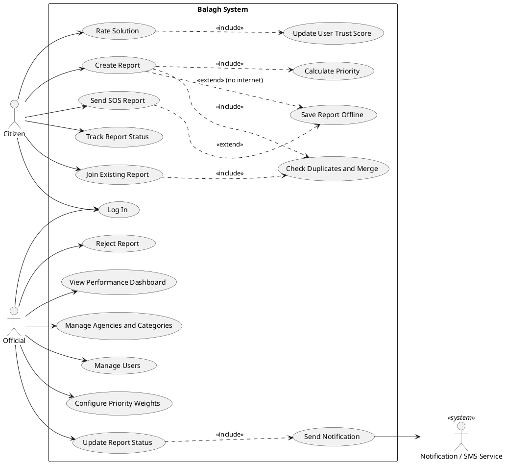
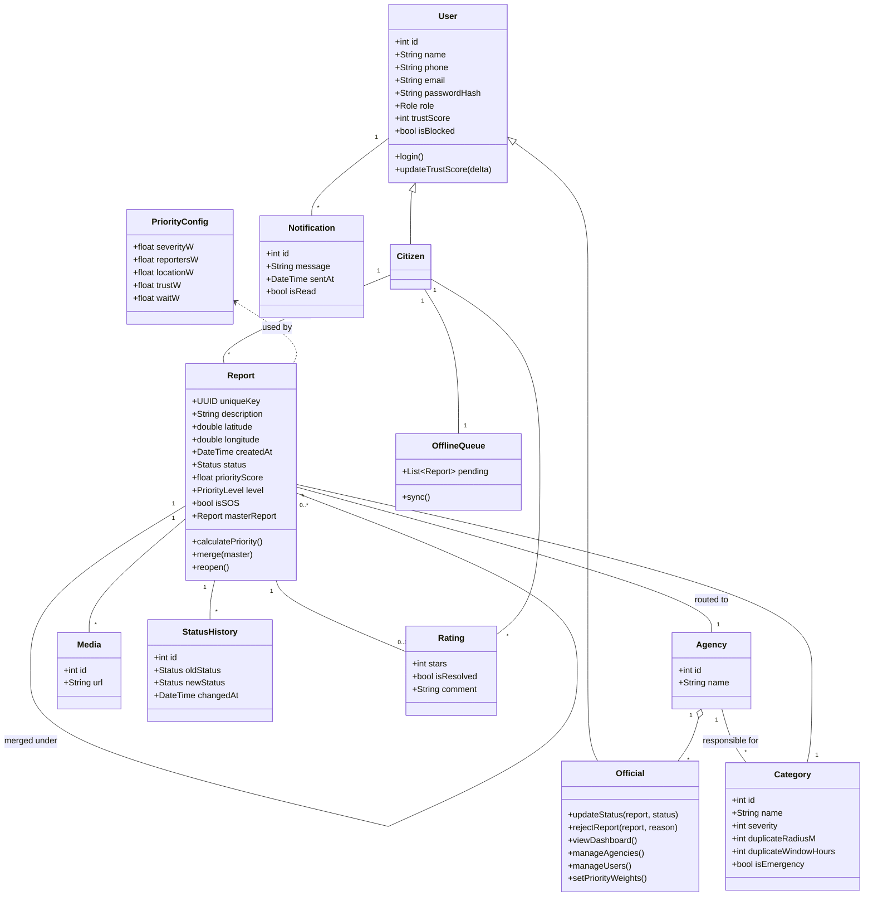

# Diagrams

## 1. Use Case Diagram
(PlantUML: paste the code into https://www.plantuml.com/plantuml or use a PlantUML extension in VS Code)

## 2. Class Diagram
(Mermaid: renders directly on GitHub)

**Note:** These diagrams are a first draft. Review and refine them as your analysis progresses.
